English | [简体中文](README.md)

# dsh-damage-pulse

<p align="center">
  
</p>

<p align="center">
  <a href="https://linux.do/t/topic/2773449" target="_blank" rel="noopener noreferrer"></a>
  <a href="#sponsors"></a>
</p>

A usage, cost, and balance monitor for DeepSeek Harness. Inspect individual requests, conversation totals, and historical spending, with the Whale Girl companion reacting to token consumption.

[Install](#installation) · [Features](#features) · [Troubleshooting](#troubleshooting) · [Advanced reference](docs/REFERENCE.en.md) · [Release notes](https://github.com/wssfk12138/dsh-damage-pulse/releases)

## Installation

**Source version: 4.3.1, supporting DeepSeek Harness 0.2.1-rc.5.** The rc.5 host skips 4.3.0 during compatibility checks. See [GitHub Releases](https://github.com/wssfk12138/dsh-damage-pulse/releases) for available downloads; if 4.3.1 has not been published yet, wait for it instead of installing an older package on rc.5.

In the desktop Plugins page, add `dsh-damage-pulse` or the file path to a complete prebuilt `.tgz` downloaded from Releases. To install the currently published npm version with the CLI:

```powershell
dsh plugin --profile desktop add dsh-damage-pulse
```

Replace `desktop` with your actual profile name. **Fully quit the desktop application, including its tray process, and reopen it.** Check the version in the balance card’s Uninstall / Update menu.

- For a specific version, use its prebuilt release `.tgz`. Repository URLs, `github:` specifications, Source code archives, and unbuilt source folders lack the runtime payload.
- If the Plugins page reports an existing installation, remove it before adding the complete package again. Keep settings and history; do not clear the ledger to fix startup errors.
- Configure `DEEPSEEK_API_KEY` through DSH credentials for official API balance queries. Usage collection and billing also work without balance credentials.

<details>
<summary>Older host compatibility</summary>

The declared peer ranges retain older hosts, including `0.1.0-rc.5`, `0.1.1-rc.2`, Desktop 2.0.4 (`0.1.2-alpha.1`), and `0.1.5-alpha.2`; see [package.json](package.json) for the exact ranges. A peer declaration does not mean every version has been tested on a real installation. This release was checked on the rc.5 desktop app.

Session amounts are included in the standard package: `conversation.session.header.actions` is used first, and `sidebar.workspaces.sessionRow.trailing` is registered when the host provides it. A fail-closed bridge supports older clients only when a native session row can be matched unambiguously; it stops when formal slots or existing amounts are detected.

Keep older hosts on their own lockfile and dependency versions. See the [reference](docs/REFERENCE.en.md) for recovery and source deployment details.

</details>

## Features

The rc.5 desktop screenshots use synthetic sample data. Plan quotas and some token summaries use response stubs to demonstrate rendering, rather than real provider query results.

### Balance card and Whale Girl

See the balance, request input/output/cache tokens, first-token and total latency, and peak/off-peak status. The balance is reconciled every 60 seconds; an unavailable query hides the amount while local statistics continue. Drag the card, move it with the keyboard, or use its context menu to open feature panels.

Whale Girl idles, blinks, and reacts to charges, cache misses, depleted balance, and recharge recovery. She can be hidden independently. Animation defaults to 80% of the card width while preserving existing custom settings.

<p align="center">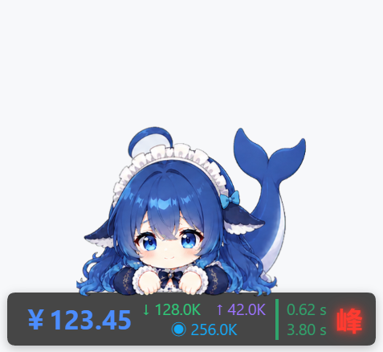</p>

<details>
<summary>More: no-balance state, context menu, workspace, and character details</summary>

<p align="center">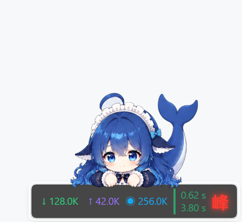</p>

<p align="center">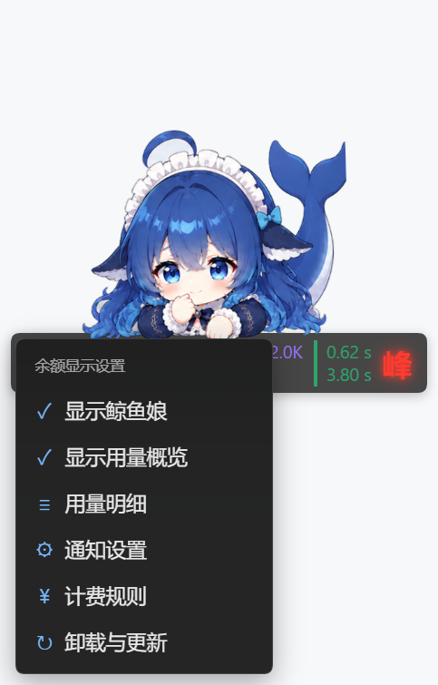</p>

<p align="center">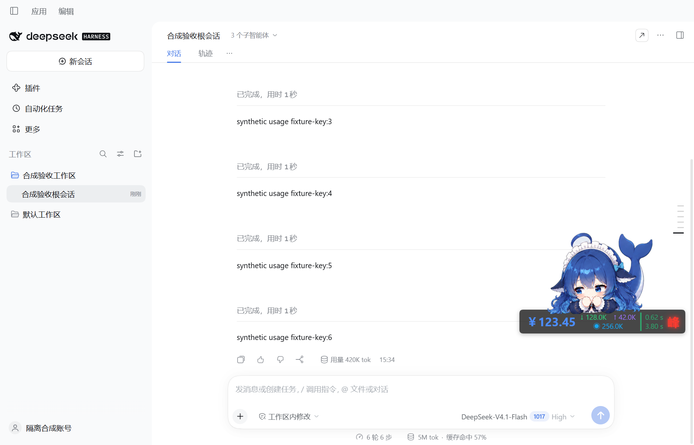</p>

<p align="center"></p>

<p align="center"></p>

</details>

### Usage history and Plan quotas

Per-request usage appears in the conversation and session totals near the composer. The draggable, resizable details window supports time/model/project/conversation filters, column selection, and per-request cost breakdowns. Summaries cover today, 7 days, 30 days, or all history, including spending, requests, tokens, and cache metrics.

The Plan quotas tab shows subscribed providers’ 5-hour and weekly windows, remaining allowance, and next refresh. It appears only when a plan is detected; an API key alone does not leave an empty tab.

<p align="center">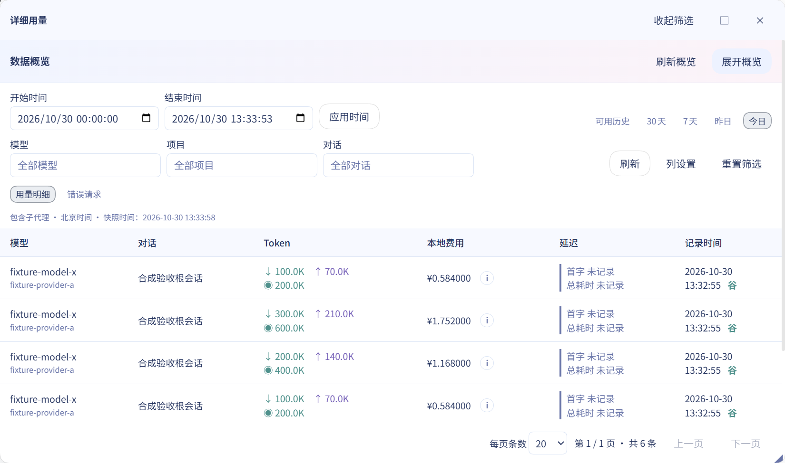</p>

<details>
<summary>More: statistics, columns, cost breakdown, and Plan quotas</summary>

<p align="center">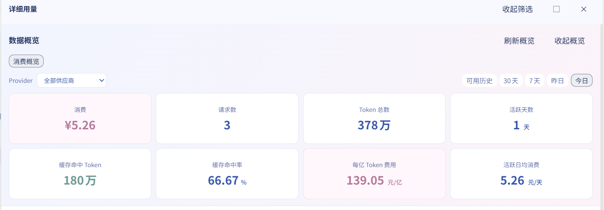</p>

<p align="center">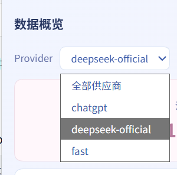</p>

<p align="center">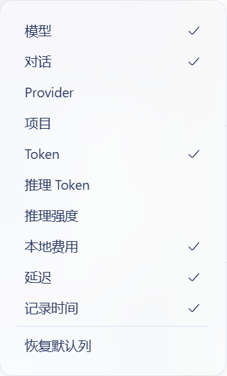</p>

<p align="center">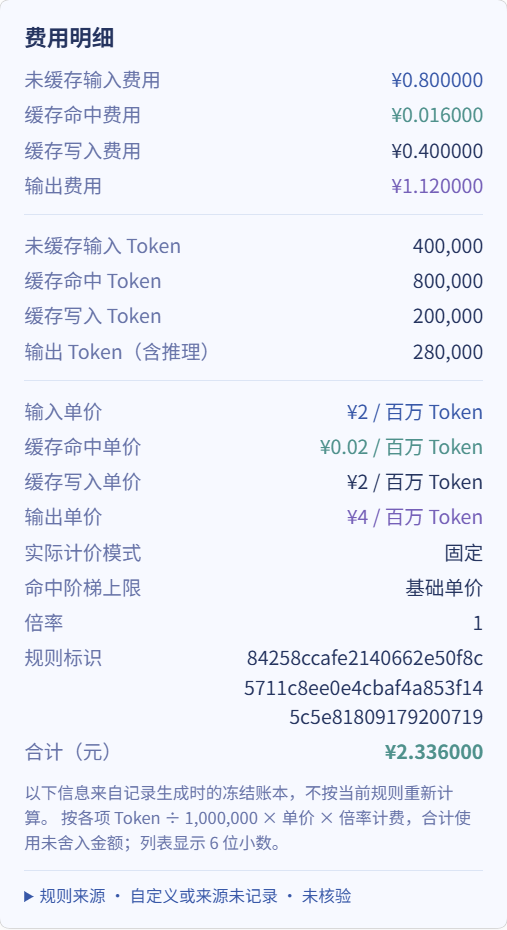</p>

The cost popover is expanded for readability; the normal interface scrolls within it.

<p align="center">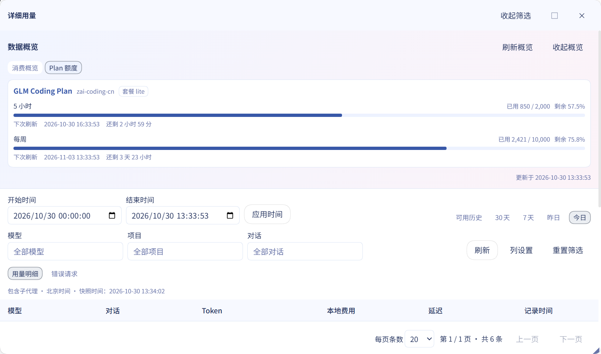</p>

</details>

### Pricing and provider balances

Billing eligibility depends on **provider + model**. Unknown models never fall back to Flash rates. Input, cache, and output are billed separately without counting reasoning tokens twice. The persistent local ledger survives restarts and prevents duplicate charges from event replay.

Edit fixed or peak/off-peak prices, tiers, and multipliers, or configure provider scripts that return a balance, custom text, or quota windows. DeepSeek’s default peak hours are 09:00–12:00 and 14:00–18:00 Beijing time on weekdays; weekends, including adjusted workdays, and public holidays are off-peak all day. Built-in prices are segmented by effective date; consult [official pricing](https://api-docs.deepseek.com/zh-cn/quick_start/pricing) and the loaded rules for actual rates.

<p align="center">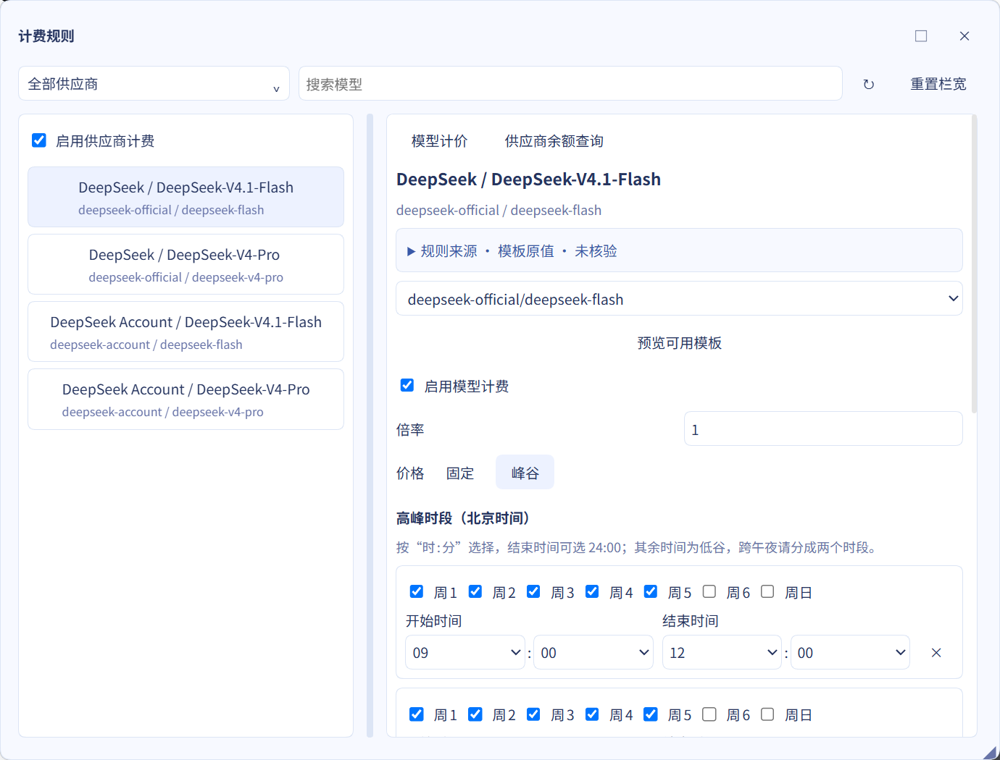</p>

<details>
<summary>More: balance scripts and advanced configuration</summary>

<p align="center">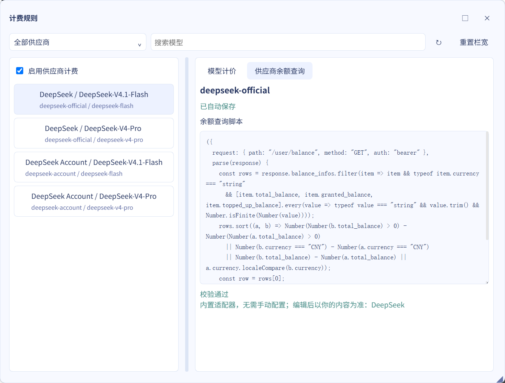</p>

See the [reference](docs/REFERENCE.en.md) for script output, historical pricing, and animation scale.

</details>

### Alerts and WeChat

Set daily budget, peak/off-peak, and consecutive cache-anomaly alerts through companion bubbles or ClawBot WeChat messages. Budget alerts do not block or cancel requests. Business notifications default to off; test messages work independently. Settings include QR login, connection status, refresh, reconnect, and disconnect.

<p align="center">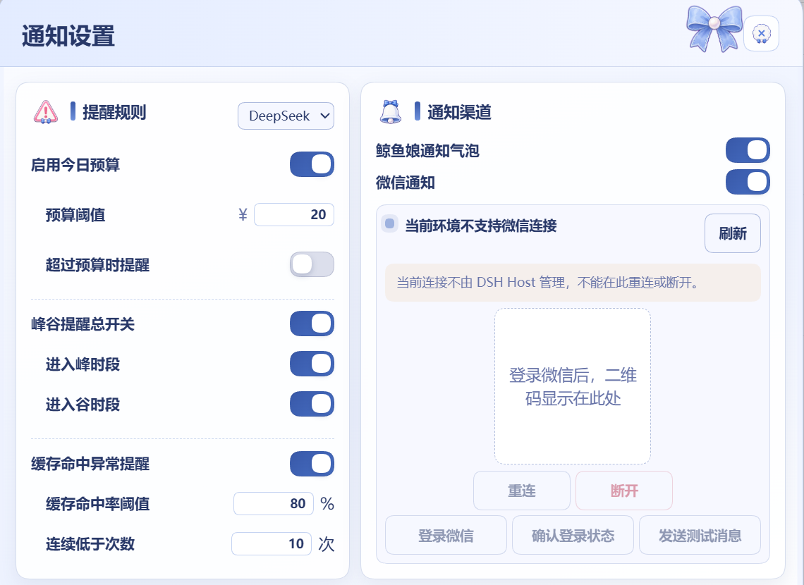</p>

<details>
<summary>More: alert rules and WeChat example</summary>

<p align="center">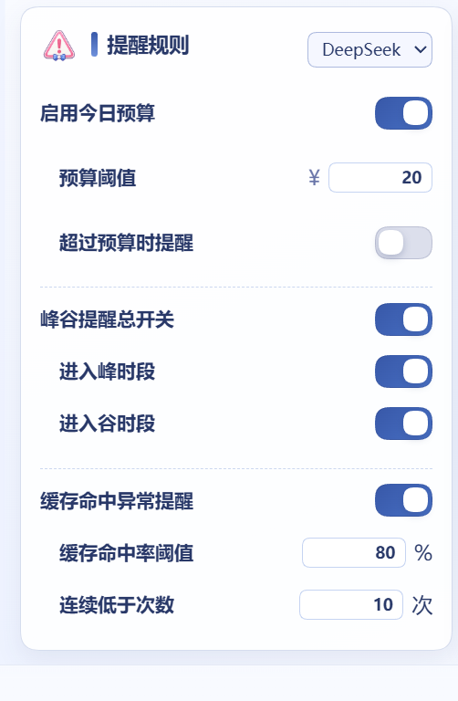</p>

<p align="center"></p>

</details>

### Modules and updates

Pet, overview, notifications, billing, and WeChat are independently removable modules. Removal state survives restarts and upgrades. Settings and history are retained by default; deselecting retention deletes the corresponding module’s data. Removing the entire plugin stops usage collection.

Uninstall / Update checks GitHub Releases and verifies the version, download source, and SHA-256 before installing. Normal upgrades retain settings, the ledger, and module-removal state.

<p align="center">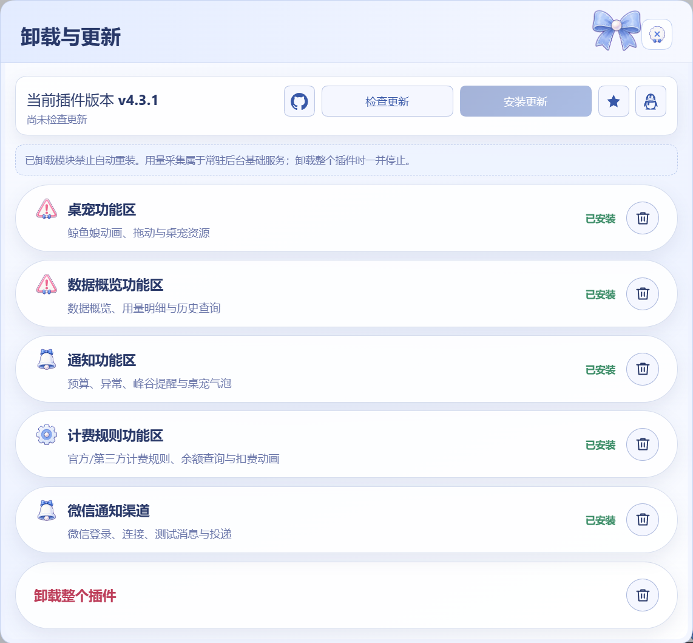</p>

## Troubleshooting

- **No balance?** Check the provider’s credentials and connection. Usage accounting does not need balance credentials. IPv4 TUN/Fake-IP (`198.18.0.0/15`) is supported; IPv6 and IPv4-mapped Fake-IP are not. A failed query hides the amount without an error code.
- **No plugin or an old interface after installation?** Fully restart the target profile and check the plugin’s own version. Remove duplicate mounts from old source integrations. If the host disabled the plugin after a startup failure, re-enable it after repairing the installation.
- **Missing `runtime/manifest.json`?** Reinstall the npm package or complete release `.tgz`, not raw source. If a package-name install selects an old version, check registry availability and the package manager’s release-age policy, or use the target release tarball.
- **Old conversations have no amount?** Wait for history projection after restarting. The standard package includes session amounts without host source edits. Report persistent issues with host/plugin versions and error text in [Issues](https://github.com/wssfk12138/dsh-damage-pulse/issues).

See the [advanced reference](docs/REFERENCE.en.md) for APIs, ClawBot setup, recovery, and development; see [Releases](https://github.com/wssfk12138/dsh-damage-pulse/releases) for historical fixes.

## Community and support

Join the discussion on [LINUX DO](https://linux.do/t/topic/2773449). Thanks to community contributors, including `@gurio-wine` (PR #17: desktop position and Whale Girl toggle fixes). [MIT license](LICENSE).

<a id="sponsors"></a>
### Model sponsor

[Fastai](https://www.fastaitoken.com/register?aff=BF9KNKFHX725&promo=WSSFK&utm=dsh-damage-pulse) supports model access during development. The affiliate link provides credits and tokens from qualifying purchases to support maintenance. GPT routing is not guaranteed to avoid model degradation; other model groups may be preferable. Installation and all plugin features work independently of any relay or top-up service.

### Support development with WeChat

<p align="center">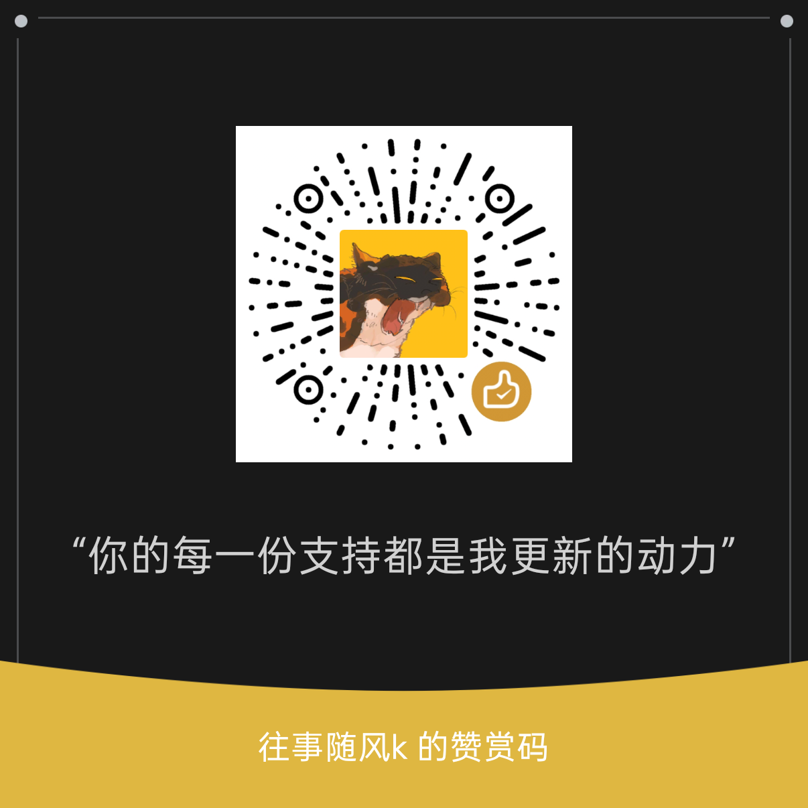</p>
