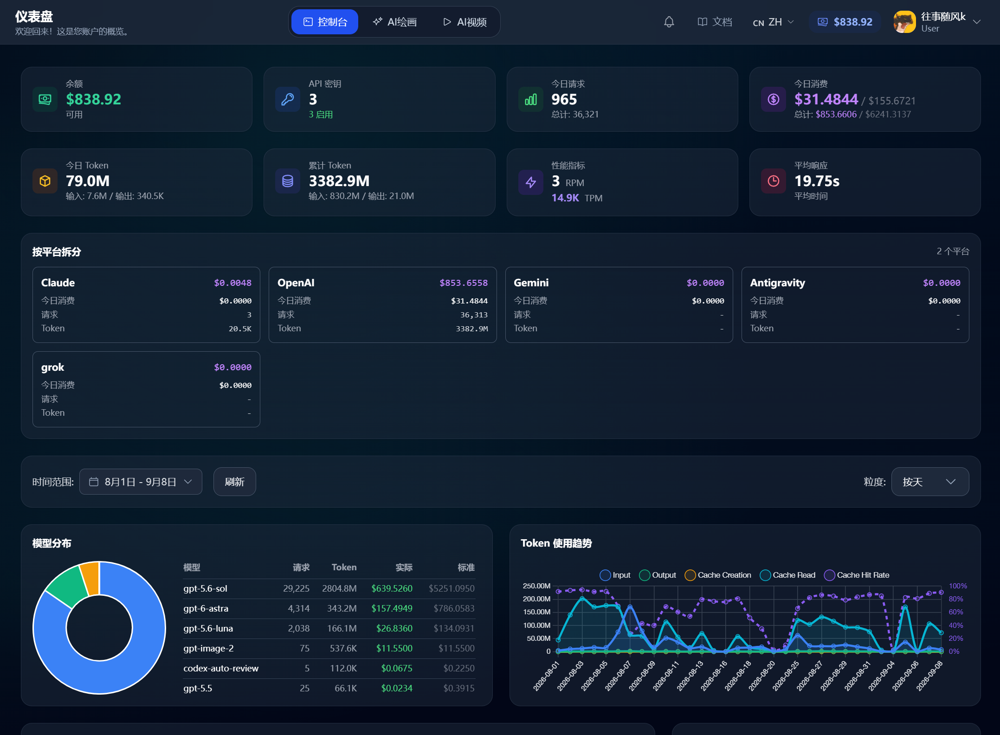
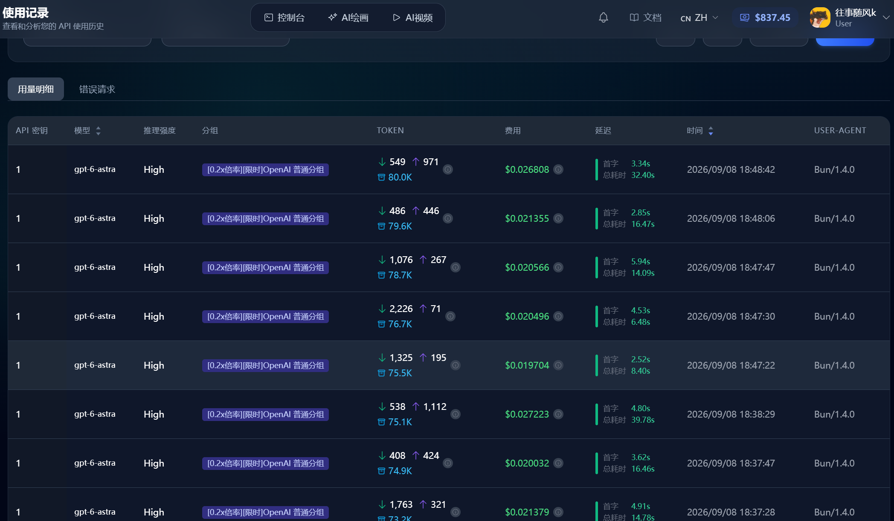

[English](README.en.md) | 简体中文

# dsh-damage-pulse

<p align="center">
  
</p>

<p align="center">
  <a href="https://linux.do/t/topic/2773449" target="_blank" rel="noopener noreferrer"></a>
  <a href="#sponsor"></a>
  <a href="#support"></a>
</p>

为 DeepSeek Harness 提供用量、费用与余额监控：查看单次调用、会话累计和历史统计，让鲸鱼娘陪你观察每次 Token 消耗。

[安装](#安装) · [功能介绍](#功能介绍) · [常见问题](#常见问题) · [高级配置与接口](docs/REFERENCE.zh-CN.md) · [更新记录](https://github.com/wssfk12138/dsh-damage-pulse/releases)

<a id="model-sponsor"></a>
感谢模型赞助商 [Fastai](https://www.fastaitoken.com/register?aff=BF9KNKFHX725&promo=WSSFK&utm=dsh-damage-pulse) 支持开发。[赞助说明](#sponsor)

## 安装

**当前源码版本：4.3.1，适配 DeepSeek Harness 0.2.1-rc.5。** 4.3.0 会被 rc.5 的兼容检查跳过。可下载版本以 [GitHub Releases](https://github.com/wssfk12138/dsh-damage-pulse/releases) 为准；若尚无 4.3.1 发布包，请等待发布，不要在 rc.5 上安装旧包。

在桌面版「插件」页添加包名 `dsh-damage-pulse`，或下载 Release 中完整的 `.tgz` 后添加其文件路径。也可用 CLI 安装 npm 当前发布版：

```powershell
dsh plugin --profile desktop add dsh-damage-pulse
```

将 `desktop` 换成实际使用的 profile 名。安装后**完整退出桌面程序（含托盘）再启动**，在悬浮卡右键的「卸载与更新」核对版本。

- 需要指定版本时，使用对应 Release 的预编译 `.tgz`；不要直接安装仓库 URL、`github:` 地址、`Source code` 压缩包或未打包的源码目录，它们缺少运行载荷。
- 页面提示已安装时，先移除再添加完整包；保留配置和历史数据，不用清空账本解决启动问题。
- 官方 API 余额通过 DSH 凭据机制配置 `DEEPSEEK_API_KEY`；没有余额凭据也可记录用量和费用。

<details>
<summary>旧版宿主兼容说明</summary>

保留 `0.1.0-rc.5`、`0.1.1-rc.2`、Desktop 2.0.4（`0.1.2-alpha.1`）、`0.1.5-alpha.2` 等旧版兼容段，实际范围见 [package.json](package.json)。声明兼容不等于每个版本都逐一实机验收；本次验收使用 rc.5 桌面版。

标准包自带会话金额：优先使用 `conversation.session.header.actions`；宿主提供 `sidebar.workspaces.sessionRow.trailing` 时追加注册。旧客户端使用严格 fail-closed 的兼容桥，只有唯一匹配原生会话行时才显示，检测到已有金额或正式席位即停用，避免重复。

旧宿主沿用自身 lock 与依赖，不混装不同预发行版本。更多恢复与源码部署说明见[参考文档](docs/REFERENCE.zh-CN.md)。

</details>

## 功能介绍

本轮 rc.5 桌面截图使用合成示例数据；Plan 额度与部分 Token 概览使用接口替身展示，不代表真实供应商查询结果。

### 余额悬浮卡与鲸鱼娘

显示余额、本次输入/输出/缓存 Token、首字与总耗时，以及峰谷状态。余额每 60 秒校准；查询不可用时不显示金额，本地统计继续工作。支持拖动、键盘移动和位置记忆，右键进入各功能面板。

鲸鱼娘会待机、眨眼，并对扣费、缓存未命中、余额耗尽和充值恢复作出反应；可以单独隐藏。动画默认按卡片宽度的 80% 显示，已有自定义比例保留。

<p align="center"></p>

<details>
<summary>查看无余额状态、右键菜单、工作区与角色细节</summary>

<p align="center"></p>

<p align="center"></p>

<p align="center"></p>

<p align="center"></p>

<p align="center"></p>

</details>

### 用量明细、历史统计与 Plan 额度

对话流显示单次用量，输入区显示会话累计；独立明细窗口支持拖动、缩放、时间/模型/项目/对话筛选、列选择及费用构成查询。统计概览提供今日、近 7 天、近 30 天与全部历史的消费、请求、Token 和缓存指标。

「Plan 额度」显示订阅的 5 小时/每周窗口、剩余额度和下次刷新时间；只有确认存在套餐时才出现，仅有 API key 不会显示空页签。

<p align="center"></p>

<details>
<summary>查看统计概览、列设置、费用构成与 Plan 额度</summary>

<p align="center"></p>

<p align="center"></p>

<p align="center"></p>

<p align="center"></p>

费用浮层为便于阅读已展开完整内容，日常界面内可滚动查看。

<p align="center"></p>

</details>

### 计费规则与供应商余额

按 **provider + model** 判断计费资格，未知模型不套用 Flash 价格；输入、缓存与输出分项计费，推理 Token 不重复叠加。历史保存在本地持久账本，重启后恢复，事件重放不会重复扣费。

可编辑固定价、峰谷价、阶梯与倍率，也可为第三方供应商配置余额查询脚本，显示金额、自定义文字或额度窗口。DeepSeek 默认高峰为北京时间工作日 09:00–12:00、14:00–18:00；周末（含调休上班）与法定节假日全天按谷价。内置价格按生效时间分段，具体价格以[官方说明](https://api-docs.deepseek.com/zh-cn/quick_start/pricing)及已加载规则为准。

<p align="center"></p>

<details>
<summary>查看余额脚本与高级设置</summary>

<p align="center"></p>

脚本返回格式、历史计价和动画比例配置见[高级参考](docs/REFERENCE.zh-CN.md)。

</details>

### 提醒与微信通知

可设置每日预算、峰谷切换和连续缓存命中异常提醒，通过鲸鱼娘气泡或 ClawBot 微信发送。预算提醒不会阻止或取消请求。业务通知默认关闭，测试消息可独立发送；设置面板提供扫码登录、连接状态、刷新、重连与断开操作。

<p align="center"></p>

<details>
<summary>查看提醒规则与微信示例</summary>

<p align="center"></p>

<p align="center"></p>

</details>

### 模块管理与更新

桌宠、数据概览、通知、计费规则和微信渠道五个模块可独立卸载，状态在重启与升级后保留。默认保留配置和历史；取消保留选项会清除对应模块的数据。整体卸载会停止用量采集。

「卸载与更新」可检查 GitHub Release，并在校验版本、下载来源与 SHA-256 后安装。正常升级保留设置、账本和已卸载模块状态。

<p align="center"></p>

## 常见问题

- **没有余额？** 先检查对应供应商凭据与连接；缺少余额凭据不影响用量统计。支持 IPv4 TUN/Fake-IP（`198.18.0.0/15`），暂不支持 IPv6 或 IPv4-mapped Fake-IP；查询失败时不显示金额或错误码。
- **安装后不出现或仍是旧界面？** 完整退出并重启目标 profile，核对插件自身版本；旧源码集成用户检查是否重复挂载。若宿主因启动失败禁用了插件，修复安装后需重新启用。
- **缺少 `runtime/manifest.json`？** 换用 npm 包或 Release 的完整 `.tgz`，不要直接安装源码。包名安装版本偏旧时，核对 registry 和包管理器新版本等待策略，或使用目标 Release 的 tgz。
- **旧会话没有金额？** 重启后等待历史投影补齐；标准包已有会话金额能力，无需手工改宿主源码。异常时附宿主版本、插件版本和错误内容到 [Issues](https://github.com/wssfk12138/dsh-damage-pulse/issues)。

接口、ClawBot 配置、旧版恢复及源码开发见[高级参考](docs/REFERENCE.zh-CN.md)。历史修复见 [Releases](https://github.com/wssfk12138/dsh-damage-pulse/releases)。

## 社区与支持

欢迎在 [LINUX DO](https://linux.do/t/topic/2773449) 交流。感谢社区贡献者，包括 `@gurio-wine`（PR #17，桌面卡片位置与鲸鱼娘开关修复）。[MIT 许可证](LICENSE)。

<a id="sponsor"></a>
### 模型赞助商

[Fastai](https://www.fastaitoken.com/register?aff=BF9KNKFHX725&promo=WSSFK&utm=dsh-damage-pulse) 支持本项目开发，提供多家模型服务。链接含邀请标记，符合条件的充值会为作者提供返利和 Token，用于持续维护。**GPT 分组不能保证不降智，建议优先考虑其他分组。** 插件安装和全部功能均不依赖中转服务或充值。

<p></p>

<p></p>

<a id="support"></a>

### 微信赞赏，支持项目开发

<p align="center"></p>
